那次爬雪山，我是从半夜开始走的。

山里的星星真的好明显。一抬眼，天上全都是星星。后来天开始微微亮起来，我看着眼前的景色，没忍住哭了出来。

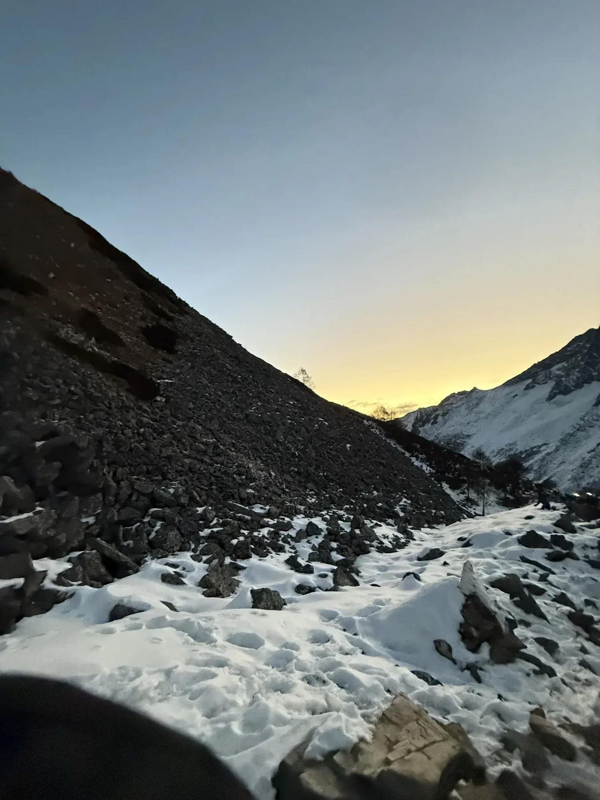

刚开始爬的时候，我走得很快，几乎一直在往前赶。后来才发现，这是一个错误的选择：体力消耗得太快，到了第十六个站点，我就倒下了，最后也没能爬到山顶。

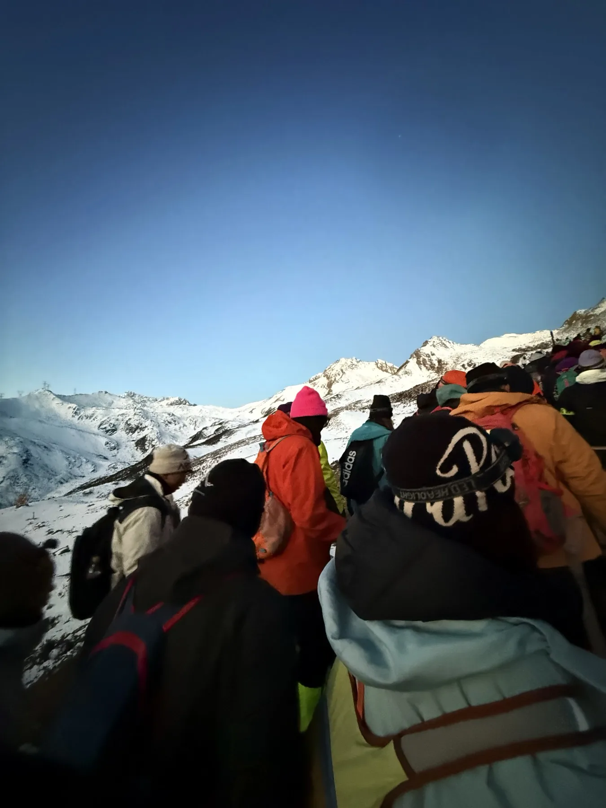

虽然没能登顶，但这趟旅程我还是很开心。半夜抬头看到的星星、天一点点亮起来的样子，还有一路上的雪山，我都很喜欢。

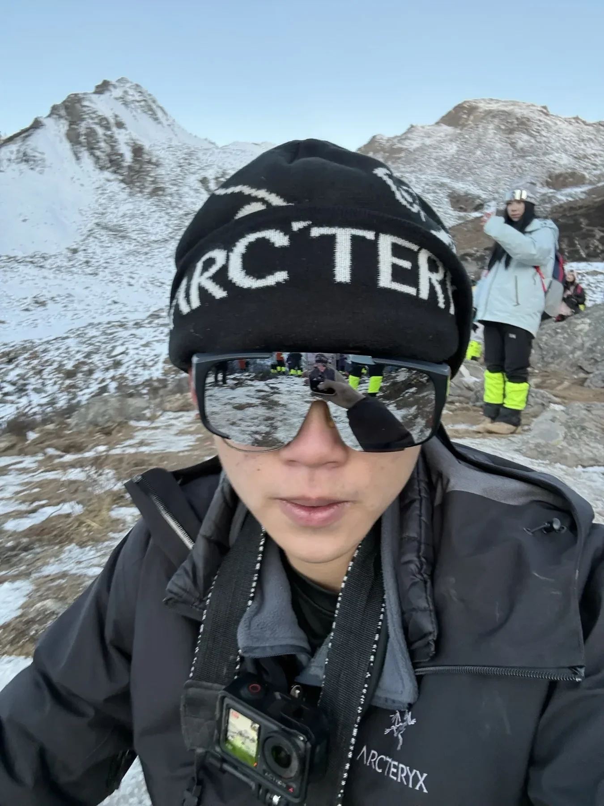

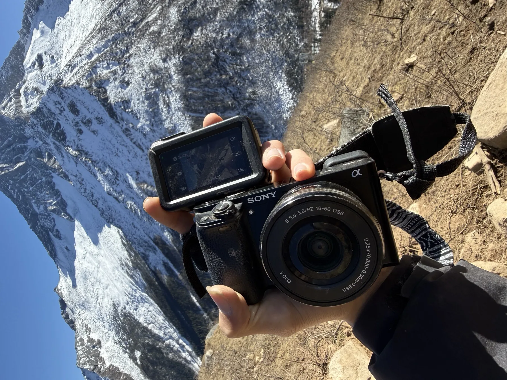

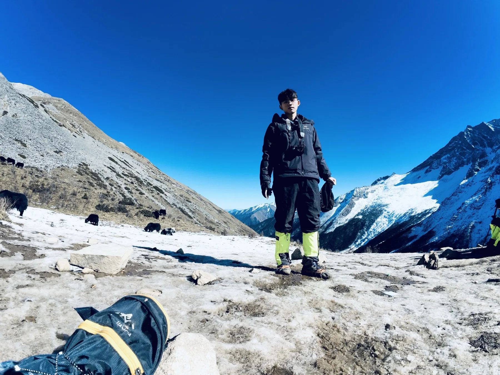

现在再看这些照片，还是会想起那天的心情。下次再去爬山，记得走慢一点，保存体力。

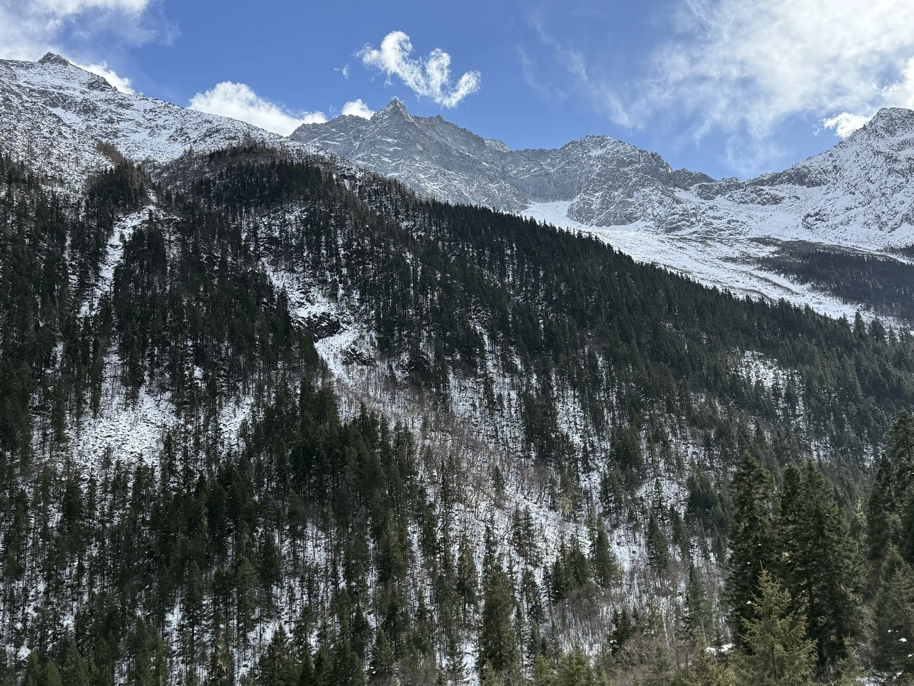

## 回到成都

从雪山回来当天，我和同学一起住了一家 20 块钱的青旅，也算是体验了一下穷游的感觉。

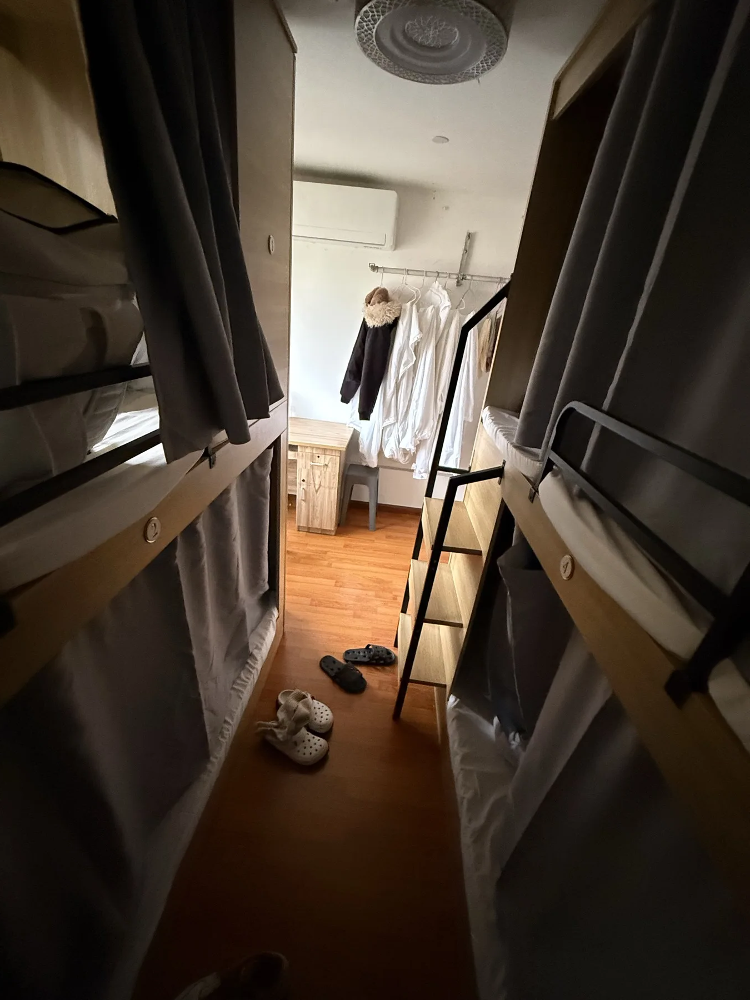

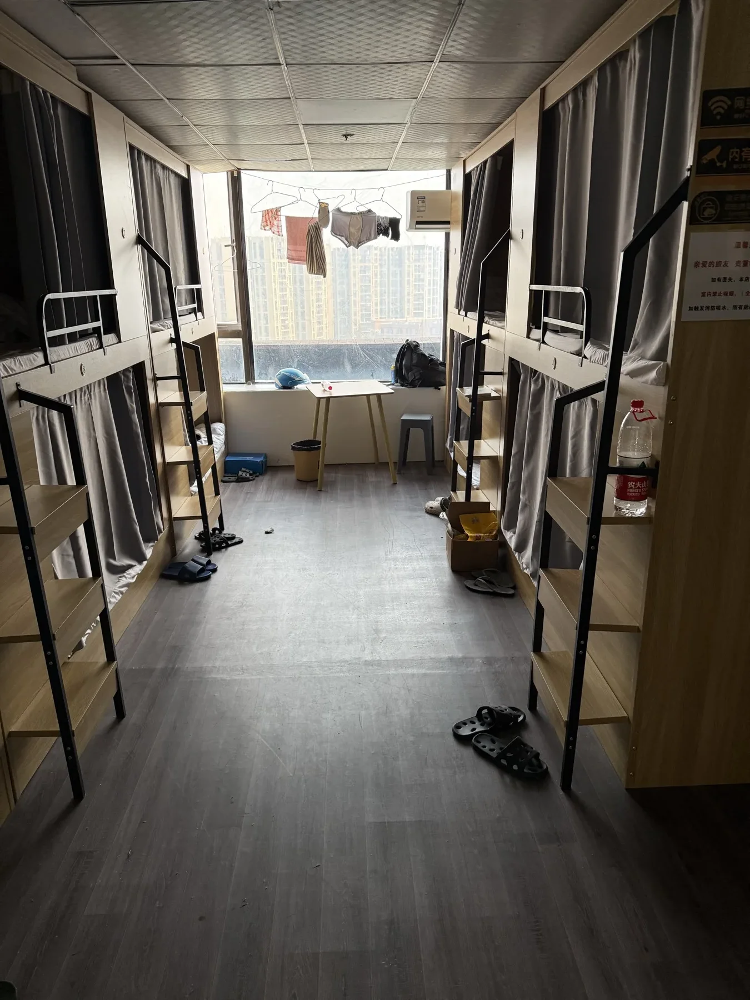

回到成都，我还拍下了路上的银杏、街景和商店。刚刚看过雪山，再看看城市里的这些画面，也是这趟旅程的一部分。

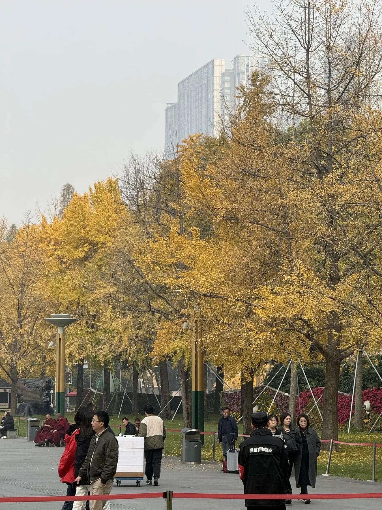

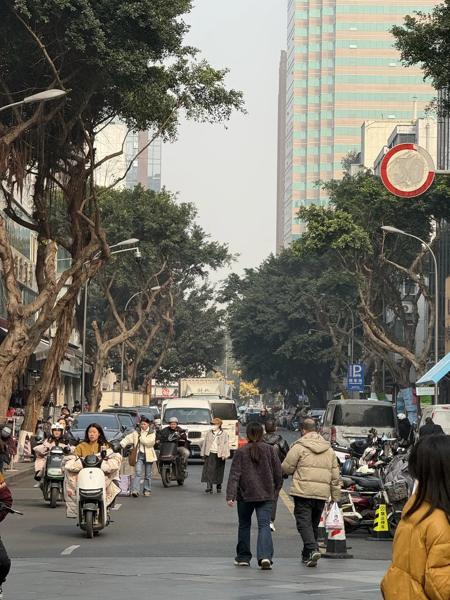

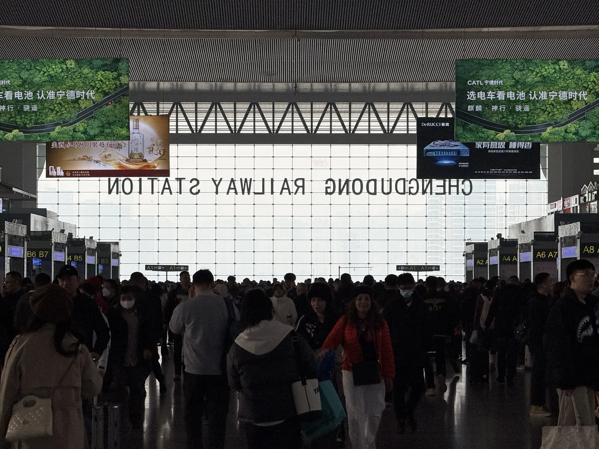
