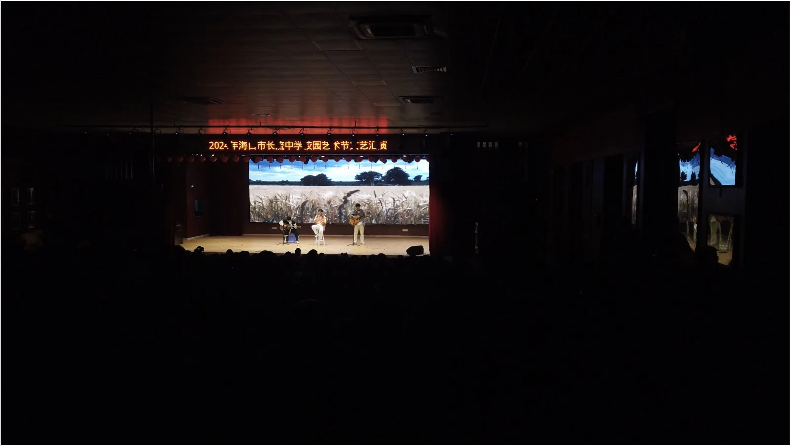
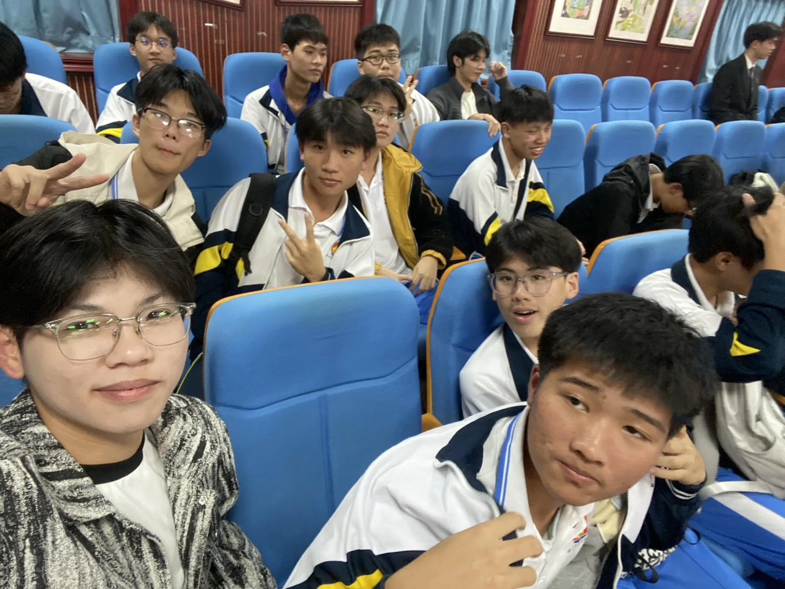
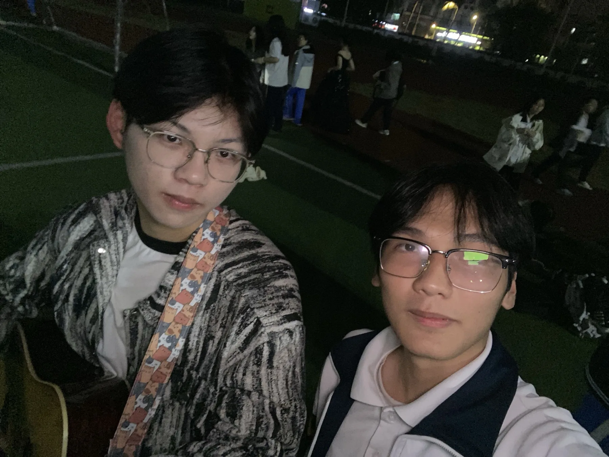

那是高三的时候。我记得，那时距离高考大概只剩下一百天了。

我站在舞台上，唱了一首《晴天》。现在再看那天的照片，还是能想起礼堂里坐着的同学，还有大家一起拍下的那些画面。

演出结束后，我们整个年级的人还在礼堂外面一起踢足球。很多人彼此并不熟悉，但那天大家还是一起踢了球，也有人在拍照。

现在回头看，那天留下来的不只是舞台上的一首歌，还有礼堂里和同学们的合照，以及演出结束后大家一起待着的那个晚上。
