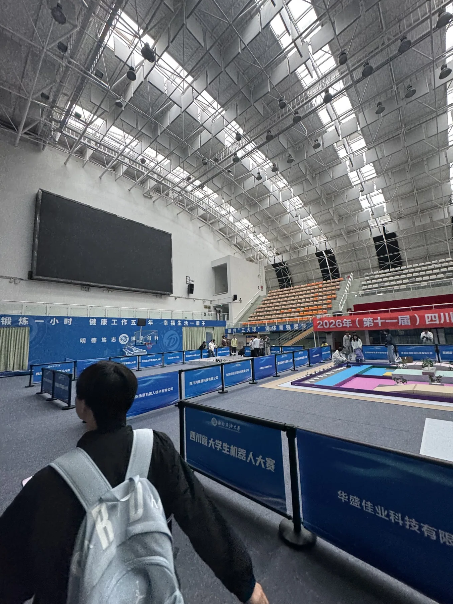
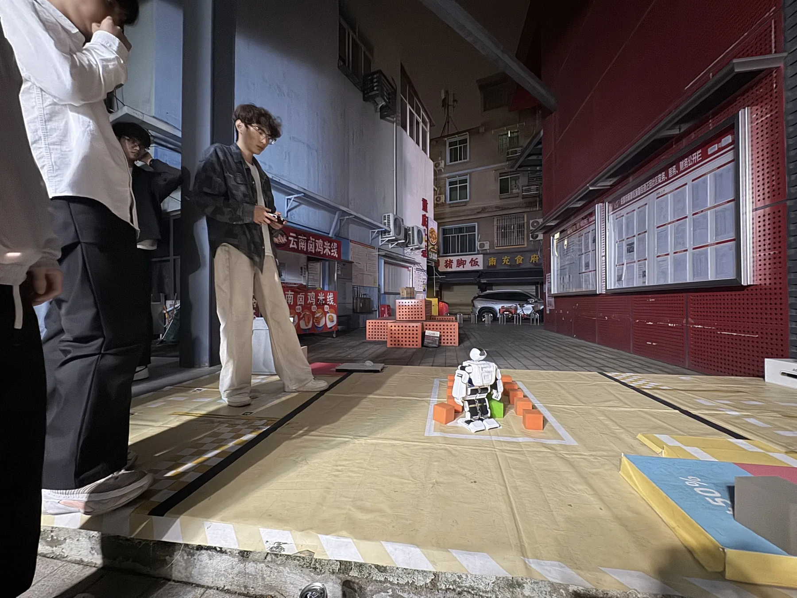
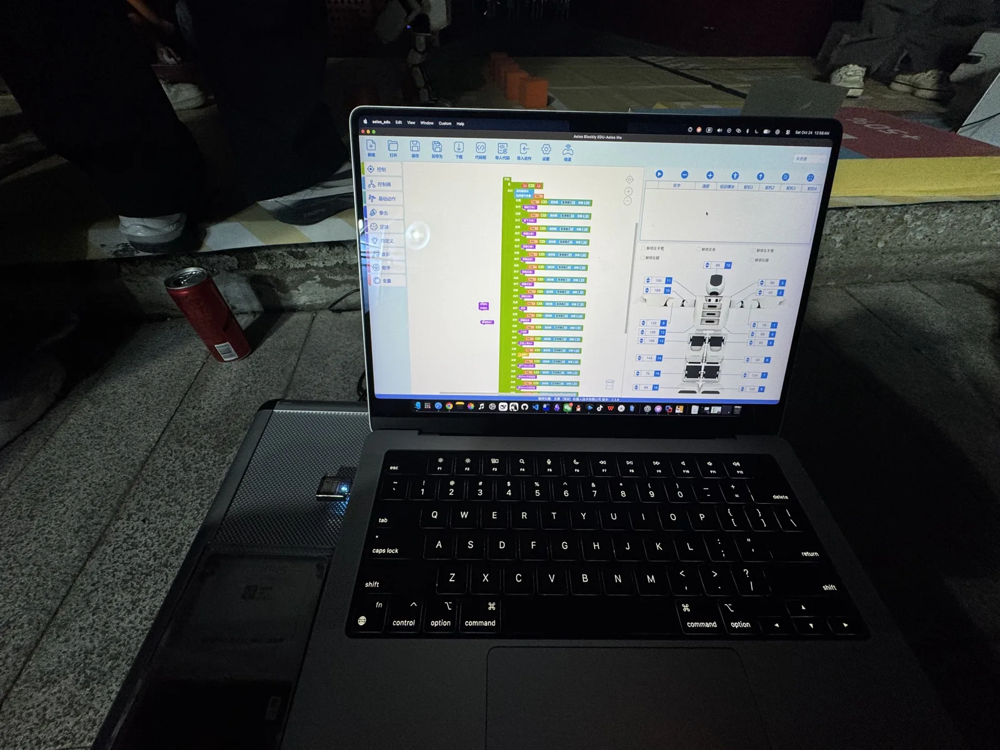
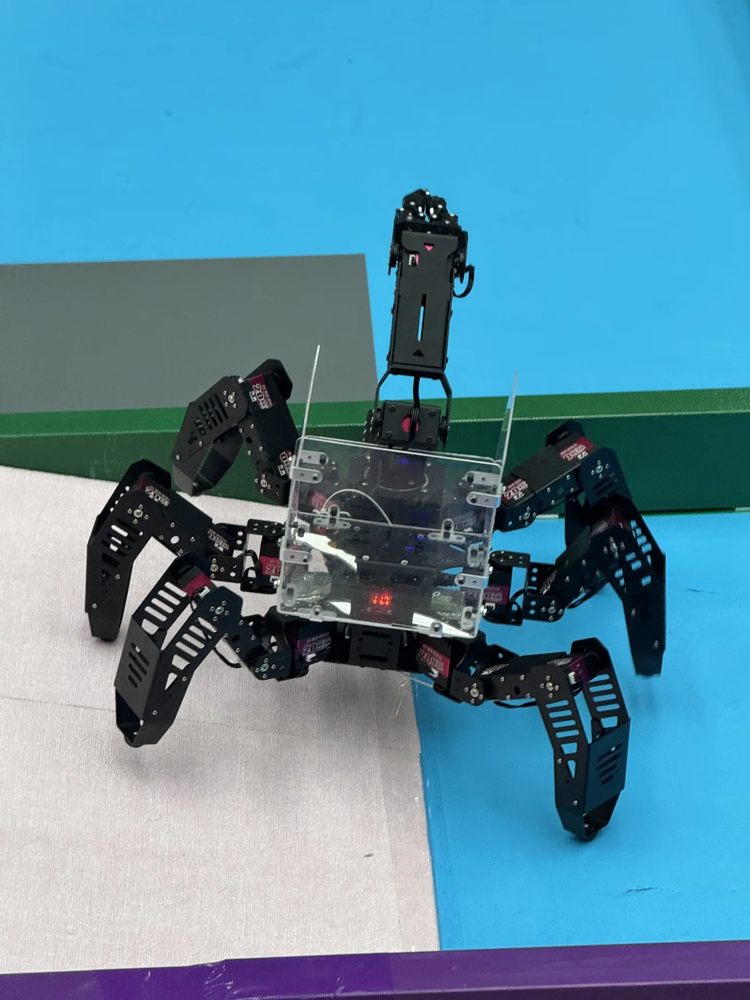
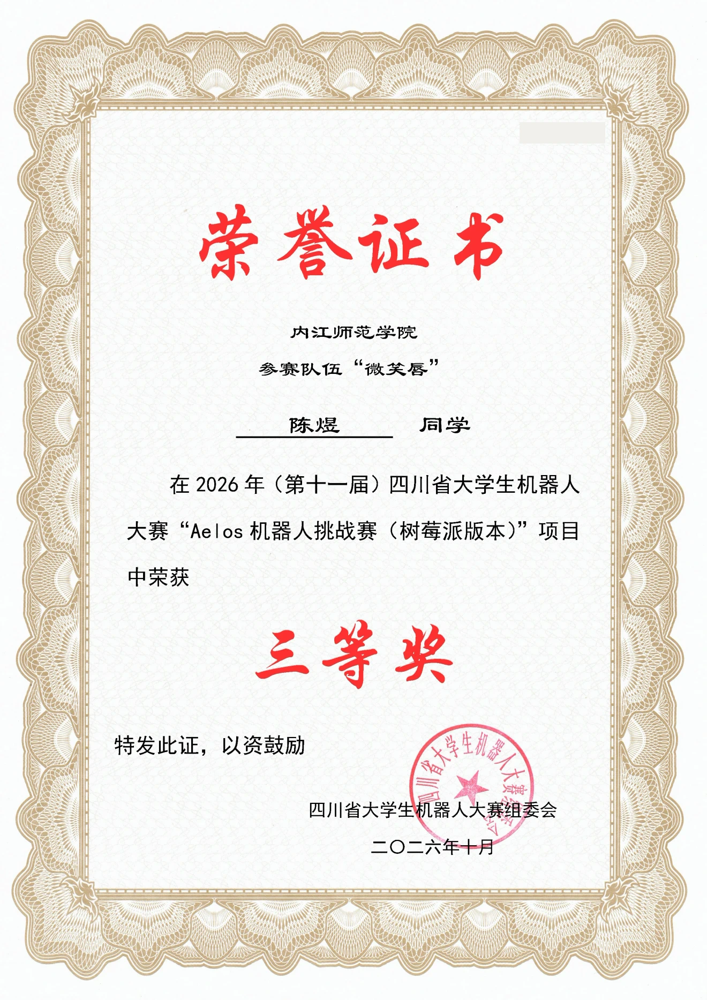

2026 年，我和队友参加了第十一届四川省大学生机器人大赛的 Aelos 机器人挑战赛（树莓派版本），最后拿到了三等奖。

比赛那天，我们去了西南石油大学。也是在那时，我第一次那么强烈地感受到学校之间的差距，心里特别后悔，后悔自己当初没有好好学习。我忍不住想，如果当时考上一所更好的学校，是不是就能遇到更多志同道合的同学，校园生活也会更精彩一些。

## 比赛当天的凌晨

说是比赛前一天，其实已经是比赛当天的凌晨了。我和队友还在调试自动机器人，可怎么调都调不好。

这件事到现在想起来还是觉得可惜。我总觉得，如果当时能把自动机器人调好，我们也许有机会拿一等奖。但这只是我的猜想，实际的结果还是三等奖。

## 看见别人的机器人之后

比赛刚开始，我和队友看到其他队伍的机器人，心态一下子崩了。看到别人的机器人居然还会后空翻，我瞬间都有点不想比下去了。

不过，最后我们还是继续比了下去。好在我们对手动机器人的操作很熟练，最终拿到了三等奖。

这次比赛让我看到了自己和别人的差距，也留下了一些遗憾。但想到我们一直调试到凌晨，后来又靠手动机器人坚持完成比赛，拿到这个结果，还是很值得记下来。
